# Saffron Check: saffron adulteration detection with transfer learning

**Is that saffron real?** A ResNet50V2 classifier tells two kinds of pure saffron apart from three common
counterfeits in a photo of a single thread. It reaches **97.3% accuracy on a held-out test set** and shows
Grad-CAM explanations. It runs entirely in your browser with TensorFlow.js; the photo never leaves your device.

[](https://peerzadarabet1807.github.io/saffron-adulteration-detection/)
[](https://colab.research.google.com/github/peerzadarabet1807/saffron-adulteration-detection/blob/main/notebooks/saffron_adulteration_transfer_learning.ipynb)
[](https://github.com/peerzadarabet1807/saffron-adulteration-detection/actions/workflows/ci.yml)
[](LICENSE)
[](https://www.tensorflow.org/)
[](https://www.tensorflow.org/js)

<p align="center">
  <a href="https://peerzadarabet1807.github.io/saffron-adulteration-detection/">
    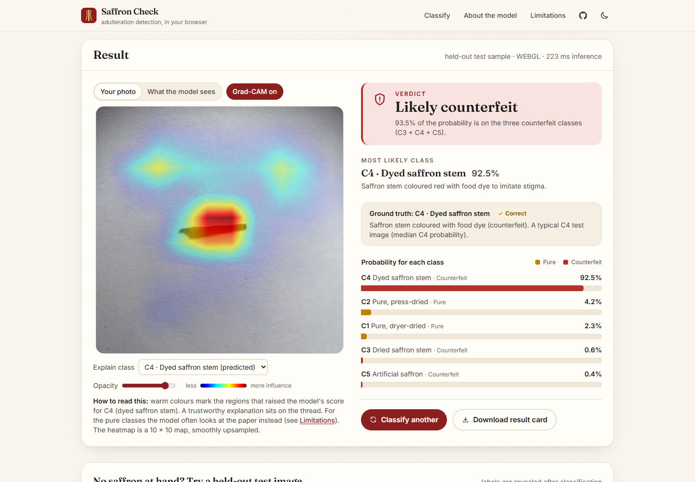
  </a>
  <br>
  <b><a href="https://peerzadarabet1807.github.io/saffron-adulteration-detection/">Try the live demo →</a></b>
  &nbsp;(47 MB classifier and 17 MB input check, downloaded once and cached; no server, no upload)
</p>

> **Research prototype.** Not a certified food-safety or laboratory test. Read the
> [limitations](#limitations-and-threats-to-validity) before trusting a result. The most important one is
> that the two *pure* classes are partly recognised by their photo background.

## TL;DR

| | Thesis CNN (baseline) | This work (ResNet50V2) |
|---|---|---|
| Model | 2-block CNN trained from scratch | ImageNet ResNet50V2, fine-tuned top 30% |
| Accuracy | ≈ 70.8% (validation)¹ | **97.3%** (held-out test, 73 / 75) |
| F1, C1 pure (dryer) | 0.80 | **1.000** (+0.20) |
| F1, C2 pure (pressed) | 0.67 | **1.000** (+0.33) |
| F1, C3 dried stem | 0.97 | **1.000** (+0.03) |
| F1, C4 dyed stem | 0.75 | **0.929** (+0.18) |
| F1, C5 artificial | 0.50 | **0.938** (+0.44) |
| Explanations | – | Grad-CAM (in the browser too) |
| Deployment | – | TF.js web app, runs on-device |

¹ The baseline numbers come from the thesis's own split and protocol, so the comparison is indicative, not
strictly like-for-like. Macro-F1 on the test set is 0.973 and macro ROC-AUC 0.999
([`results/metrics.json`](results/metrics.json)).

**The honest headline:** 97.3% on 75 test images, with both errors being dyed stems (C4) taken for artificial
saffron (C5), the thesis model's old weak spot. Grad-CAM, however, shows the model often uses the **paper
background** to recognise the pure classes, because those classes were photographed on different paper. The
perfect C1/C2 scores are therefore partly a data-collection artefact (see [Explainability](#explainability)).
An [input check](#input-check) now runs first and holds back the verdict for photos that do not look like a
single thread on paper. In testing it turned away 2 of 75 saffron-thread photos (2.7%, both pure classes) and
none of 131 photos of other things.

## Contents

[The problem](#the-problem) · [Dataset](#dataset) · [Method](#method) · [Results](#results) ·
[Explainability](#explainability) · [Input check](#input-check) · [Limitations](#limitations-and-threats-to-validity) ·
[Web app](#the-web-app) · [Reproduce training](#reproduce-the-training) · [Run locally](#run-the-web-app-locally) ·
[Repository](#repository-structure) · [Model card](#model-card) · [Roadmap](#roadmap) · [Citation](#citation)

## The problem

Saffron is the most expensive spice by weight, so it is also one of the most adulterated. Common frauds pass
off the plant's pale **stem** (style) as the valuable red **stigma**, dye those stems red, or sell fully
**synthetic threads**. To make it harder, genuine saffron itself looks different depending on how it was
dried: dryer-dried and press-dried stigmas differ in colour and shape, which makes honest producers' saffron
look suspicious to buyers.

This project classifies a photo of one thread into five classes:

| Class | Group | Description |
|---|---|---|
| **C1** | Pure | Saffron stigma dried with a dryer |
| **C2** | Pure | Saffron stigma dried by pressing |
| **C3** | Counterfeit | Dried saffron stem |
| **C4** | Counterfeit | Saffron stem coloured with food dye |
| **C5** | Counterfeit | Synthetic / artificial saffron |

It started as my B.Tech thesis in Agricultural and Food Engineering at IIT Kharagpur, supervised by
Dr. Mamoni Banerjee (RMSOEE). This repository rebuilds it as a reproducible transfer-learning pipeline with an
honest evaluation, explanations and an on-device web app.

## Dataset

<p align="center">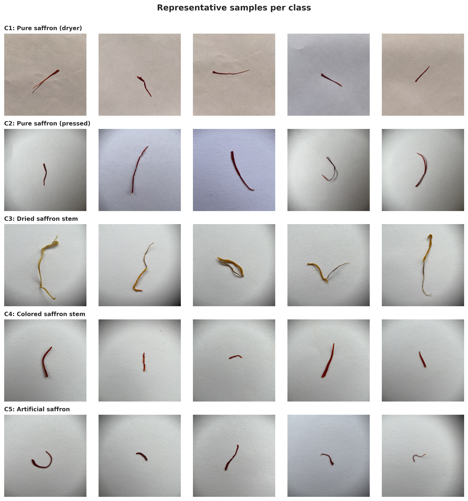</p>

- **Collection:** 500 photos I took with a phone (iPhone, median 3024 × 3024 px; min 1922 × 1922, max
  4032 × 3024) of saffron collected in **Pampore, Kashmir**: one thread per photo, on paper, 100 per class.
  All are Display-P3 JPEGs; 100 carry an EXIF rotation.
- **Cleaning:** every file is integrity-checked, EXIF-rotated and converted to RGB (all 499 were already RGB),
  and screened for tiny or blank images. MD5 de-duplication removed **one exact duplicate**
  (`C2/IMG_9978.jpg`, a copy of `IMG_9978(1).jpg`, see [`results/rejected_images.csv`](results/rejected_images.csv)),
  leaving **499 images**.
- **Split:** stratified 70 / 15 / 15 with seed 42.

  | | C1 | C2 | C3 | C4 | C5 | Total |
  |---|---|---|---|---|---|---|
  | Train | 70 | 69 | 70 | 70 | 70 | **349** |
  | Validation | 15 | 15 | 15 | 15 | 15 | **75** |
  | Test | 15 | 15 | 15 | 15 | 15 | **75** |

  The imbalance ratio is 1.01, so no class weights were used.
  ([`results/class_distribution.png`](results/class_distribution.png))
- **Availability:** the photos are **not redistributed** in this repository. Ten downscaled test images ship
  with the web app as samples. [`scripts/reproduce_test_split.py`](scripts/reproduce_test_split.py) recreates
  the exact split from the raw folder and checks it against the published counts.

## Method

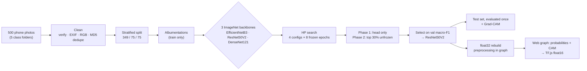

**Architecture.** `image (300×300×3, raw 0–255) → preprocess → backbone (ImageNet, include_top=False) →
GlobalAveragePooling → Dropout → Dense(5) "logits" → Softmax`. The logits layer is kept separate so Grad-CAM can
use pre-softmax scores.

**Why normalisation lives inside the model.** Each backbone expects different input scaling (EfficientNet
rescales internally, ResNet50V2 wants `[-1, 1]`, DenseNet121 wants ImageNet mean/std). A small `preprocess`
block at the front of the graph means the exported model takes **raw RGB pixels**. A client cannot pair the
wrong normalisation with the wrong model, and the browser only has to resize.

**Why hue augmentation is mild.** Colour is the main physical cue that separates genuine stigma from dyed stems
(C4) and synthetic threads (C5). Strong hue shifts could make a C4 thread look like C1 and teach the model to
ignore the very signal it needs, so hue is limited to ±4 and saturation to ±12. The rest of the augmentation is
geometric and photometric: random resized crop (60–100%), flips, 90° rotations, mild affine,
brightness/contrast, CLAHE and Gaussian blur.

<p align="center">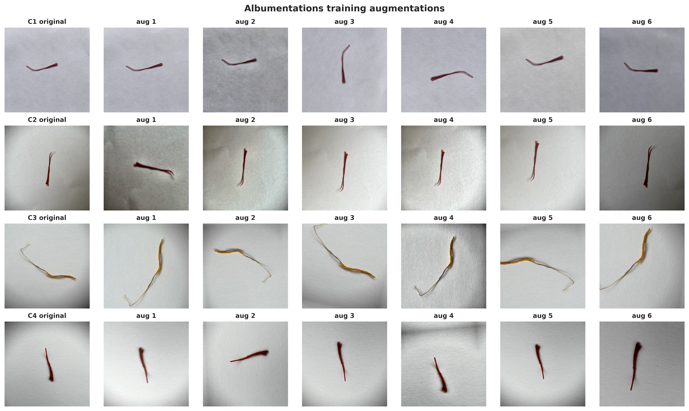</p>

**Training.**
- *Two phases.* Phase 1 trains only the new head on the frozen backbone (≤ 15 epochs). Phase 2 unfreezes the
  top 30% of backbone layers at a 10× lower learning rate (≤ 35 epochs). BatchNorm layers stay frozen
  throughout, because updating their statistics with batches of 16 destroys pretrained features. Phase 2
  replaces phase 1's weights only if it improves validation macro-F1.
- *Optimiser.* AdamW (weight decay 1e-4, not applied to biases/BN) with label smoothing 0.1.
- *Learning rate.* A cosine schedule with a one-epoch warm-up, multiplied by a ReduceLROnPlateau-style factor
  (×0.5 after 3 stagnant epochs of validation loss). Keras cannot combine the two out of the box, so the
  notebook implements a small callback.
- *Early stopping* with patience 8 on validation macro-F1, and **mixed precision** (`mixed_float16`) on a
  Colab T4.
- *Selection* uses **validation macro-F1** rather than accuracy, because accuracy can hide a model that
  sacrifices one class (historically C5).

## Results

### Hyperparameter search

Four of the eight grid configurations (learning rate × batch size × dropout) were sampled once and used for
all backbones, each trained for 8 frozen-backbone epochs (14.1 min in total on a T4).

| Validation macro-F1 | lr 1e-3, bs 16, drop 0.4 | **lr 1e-3, bs 16, drop 0.2** | lr 5e-4, bs 16, drop 0.4 | lr 1e-3, bs 32, drop 0.2 |
|---|---|---|---|---|
| EfficientNetB3 | 0.8939 | **0.9195** | 0.8792 | 0.8939 |
| ResNet50V2 | 0.8927 | **0.8928** | 0.8025 | 0.8676 |
| DenseNet121 | 0.8529 | **0.8529** | 0.7196 | 0.8236 |

The same configuration won for every backbone (**lr 1e-3, batch 16, dropout 0.2**), but only EfficientNetB3's
win is clear. ResNet50V2's is a 0.0001 margin, and DenseNet121's is an exact tie broken by lower validation
loss. The lr 5e-4 run was the worst for every backbone (most clearly DenseNet121, 0.72), but it was only
sampled together with dropout 0.4, so the two effects are confounded.
([`results/hyperparameter_search.csv`](results/hyperparameter_search.csv))

### Backbone comparison

| Backbone | Phase-1 best val F1 (frozen) | Final val macro-F1 | Val accuracy | Val log-loss | Params | Train time |
|---|---|---|---|---|---|---|
| **ResNet50V2** (selected) | 0.9076 | **1.0000** | 1.0000 | **0.1246** | 23.58 M | 2.6 min |
| EfficientNetB3 | 0.9204 | 0.9867 | 0.9867 | 0.1555 | 10.79 M | 3.5 min |
| DenseNet121 | 0.9208 | 0.9737 | 0.9733 | 0.2099 | 7.04 M | 3.7 min |

<p align="center">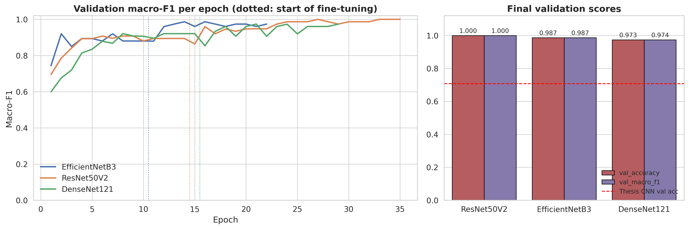</p>

Fine-tuning improved every backbone by 5 to 9 F1 points over its frozen phase. **ResNet50V2 was selected, but
treat this as a near-tie:** on 75 validation images, 1.000 vs 0.987 is a difference of **one image**, and the
validation set had already been used for early stopping and the hyperparameter search. EfficientNetB3 would
have been a reasonable choice at less than half the size. The selected model was rebuilt in float32 for
deployment, and it agreed with the mixed-precision model on 100% of validation images (max probability
difference 0.0000). (Phase-1 scores are from the notebook's training log; the rest are from
[`results/model_comparison.csv`](results/model_comparison.csv).)

<p align="center">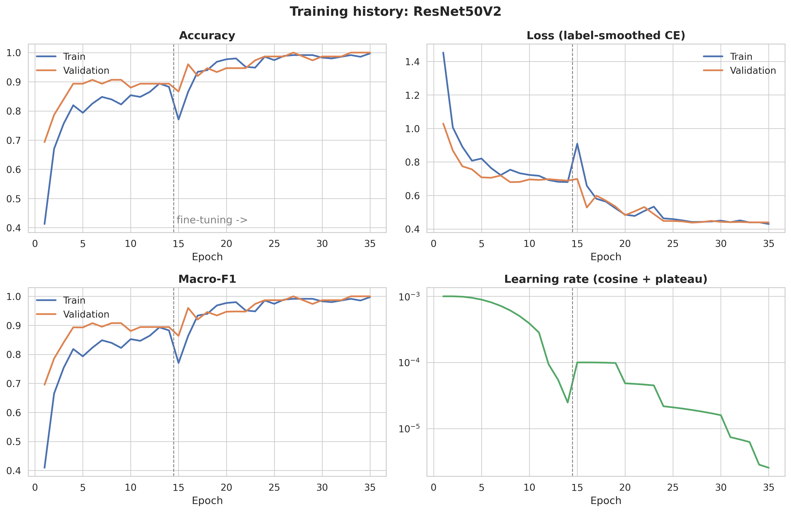</p>

Validation tracks training closely, with no widening gap. The dip right after the dashed line is the first
fine-tuning epoch disturbing the pretrained features. The learning-rate panel shows the warm-up, the cosine
decay and the stepped plateau reductions.

### Held-out test set (75 images, evaluated once)

| Metric | Value |
|---|---|
| Accuracy | **0.9733** (73 / 75) |
| Macro-F1 | **0.9732** |
| Weighted-F1 | 0.9732 |
| Macro ROC-AUC (one-vs-rest) | **0.9993** |

| Class | Precision | Recall | F1 | ROC-AUC | Avg. precision |
|---|---|---|---|---|---|
| C1 pure (dryer) | 1.000 | 1.000 | 1.000 | 1.000 | 1.000 |
| C2 pure (pressed) | 1.000 | 1.000 | 1.000 | 1.000 | 1.000 |
| C3 dried stem | 1.000 | 1.000 | 1.000 | 1.000 | 1.000 |
| C4 dyed stem | 1.000 | **0.867** | 0.929 | 0.998 | 0.992 |
| C5 artificial | **0.882** | 1.000 | 0.938 | 0.999 | 0.996 |

<p align="center">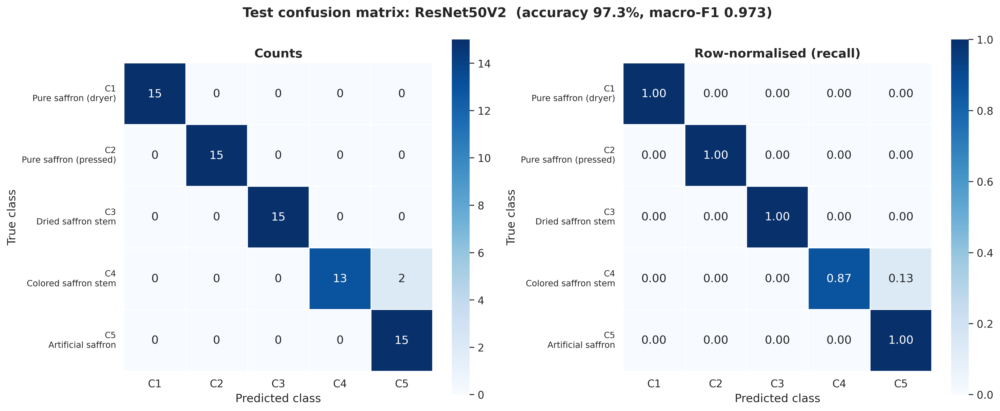</p>

**Both errors are dyed stems (C4) predicted as artificial saffron (C5).** That is the same confusion the thesis
CNN had, now down to 2 of 15 C4 test images. It makes physical sense: both are red-dyed, non-stigma material.
One of the two mistakes was made with **78.6% confidence** and the other with 57.1%
([`results/gradcam/gradcam_index.csv`](results/gradcam/gradcam_index.csv)), a reminder that the
probabilities are not calibrated. The web app includes the confident one as a sample, so visitors can see a
real mistake.

<p align="center">
  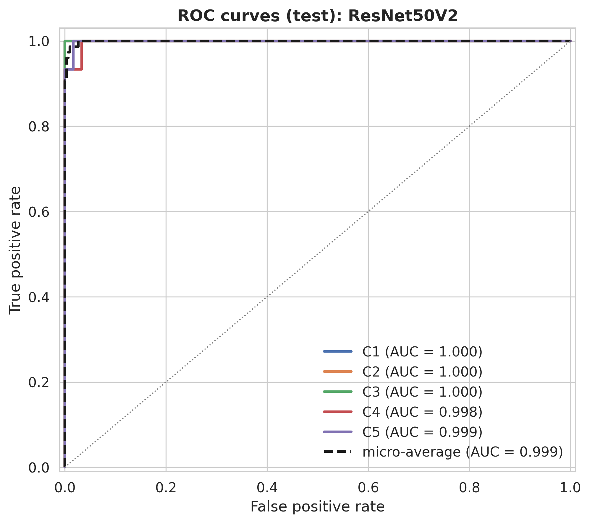
  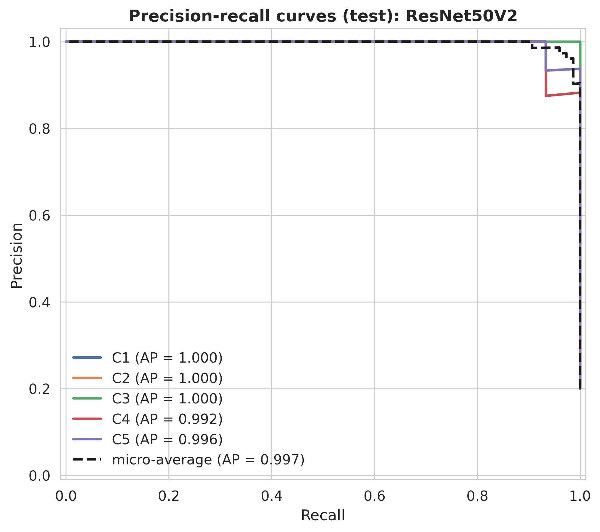
</p>

The ROC and precision-recall curves are near-perfect because, apart from the two errors, the right class
nearly always gets the highest score. With 15 positives per class, a single swapped ranking shows up as the
small dents in C4 and C5.

<p align="center">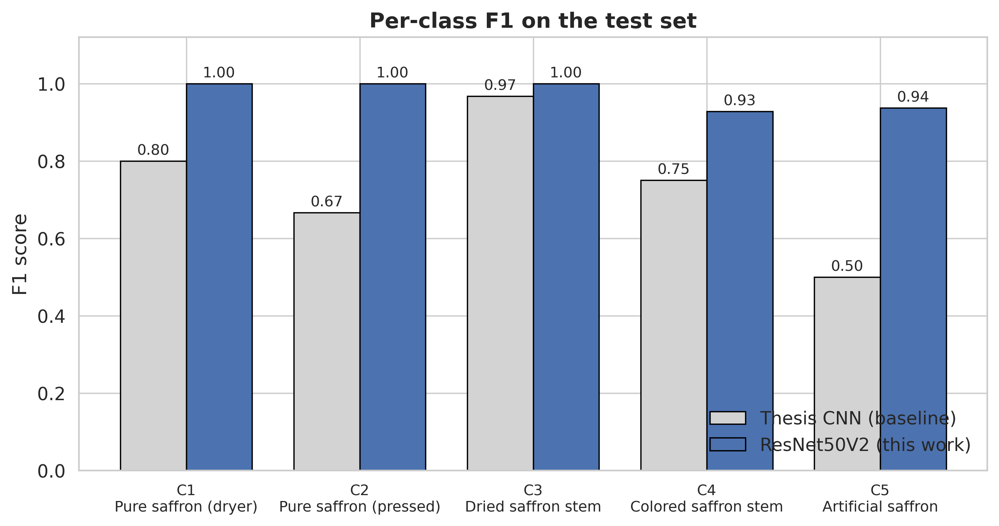</p>

The largest gains over the thesis model are on C5 (+0.44) and C2 (+0.33). C3 (dried stem, visibly pale) was
already easy. Remember the protocol caveat: the thesis numbers are from its own split.

<p align="center">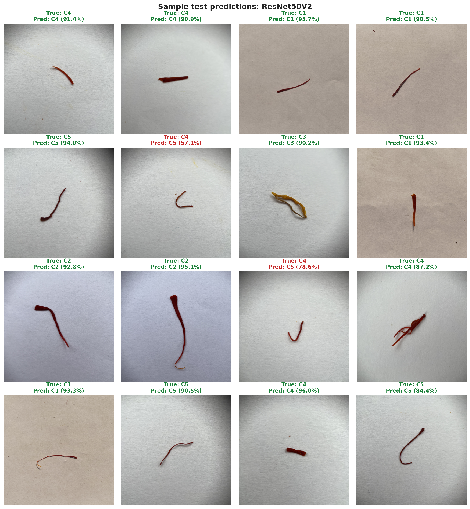</p>

### Reproducibility check

Running [`scripts/reproduce_test_split.py`](scripts/reproduce_test_split.py) and
[`scripts/make_reference_predictions.py`](scripts/make_reference_predictions.py) on the raw photos outside
Colab (TF 2.20.0 / Keras 3.13.2, CPU) recreates the identical split (349 / 75 / 75, the same rejected
duplicate) and **the same test result**: accuracy 0.9733, the identical confusion matrix, and both C4 → C5
errors with confidences 0.786 and 0.571. The 11 deterministically chosen Grad-CAM examples also match
`gradcam_index.csv` to four decimals.

## Explainability

<p align="center">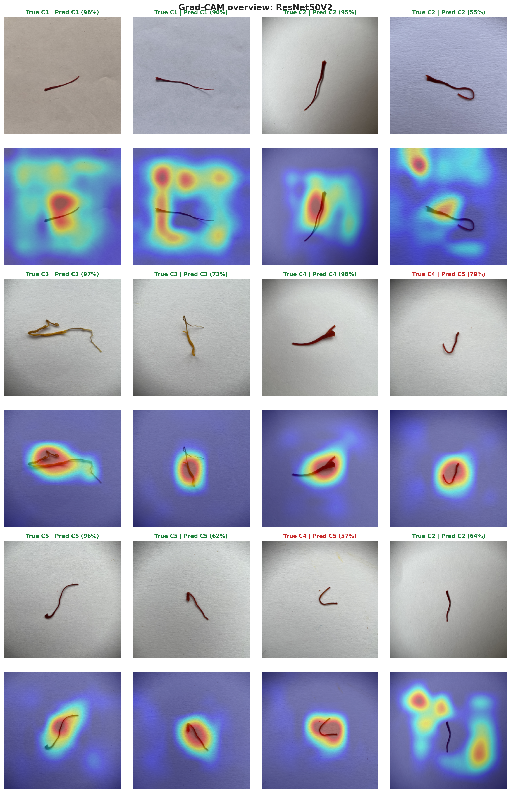</p>

Grad-CAM (Selvaraju et al., 2017) highlights the regions that raised the predicted class's score. It is the
most informative figure in this project, because it shows two different behaviours:

- **C3, C4 and C5:** the heatmaps sit tightly **on the thread**, which is the behaviour we want.
- **C1 and C2:** the heatmaps are often **diffuse and spread over the background paper**, not the thread.

The photos explain why. **C1 was photographed on a distinct beige/grey paper, while C2 was mostly shot on bluish
or vignetted white paper; C3, C4 and C5 share a similar white vignetted background** (see the dataset grid
above). This is an **acquisition confound**. The model can tell the pure classes apart partly by *what paper
they were photographed on*, so their perfect test scores are likely helped by background cues rather than
earned by thread appearance alone. The test set shares the confound, so the test score cannot reveal it; only
the explanations do.

What would fix it:
1. **Re-photograph all classes on one standardised background** under fixed lighting (the single most
   important step).
2. **Background-randomisation augmentation**, or **segment-and-crop** the thread so the background cannot be
   used.
3. **An external test set** collected on other days, papers, lights and phones.

**Grad-CAM in the browser, without gradients.** TF.js graph models cannot backpropagate, but for this
architecture Grad-CAM needs no gradients. With global average pooling followed by a linear layer,

$$
y^c = \sum_k w_k^c \frac{1}{HW}\sum_{i,j} A^k_{ij} + b^c
\;\Rightarrow\;
\alpha_k^c = \frac{1}{HW}\sum_{i,j}\frac{\partial y^c}{\partial A^k_{ij}} = \frac{w_k^c}{HW}
\;\Rightarrow\;
\text{Grad-CAM}^c = \mathrm{ReLU}\Big(\sum_k \alpha_k^c A^k\Big) = \frac{1}{HW}\,\mathrm{ReLU}\Big(\sum_k w_k^c A^k\Big),
$$

which is classic CAM up to a constant that disappears after normalisation.
[`scripts/build_web_model.py`](scripts/build_web_model.py) therefore adds a 1×1 convolution carrying the
logits weights, so one forward pass returns both the probabilities and 10 × 10 class maps. Checked on 30 real
images, the maps correlate with gradient-based Grad-CAM at **r = 1.000000**.

## Input check

The classifier always answers with one of its five classes, whatever the photo shows. A second, small model now
runs first and asks one question: does this photo look like the training photos, one thread on light paper? It
never changes the classifier's answer, and it says nothing about pure or counterfeit: counterfeit threads (C3 to
C5) must pass as readily as pure ones, because they are exactly what the classifier exists to catch.

**How it works.** The image encoder of [TinyCLIP ViT-8M/16](https://huggingface.co/wkcn/TinyCLIP-ViT-8M-16-Text-3M-YFCC15M)
(Microsoft, MIT licence) embeds the classifier's 300 × 300 input, area-resized to 224 × 224. The score is the
cosine similarity with the nearest of five class prototypes, the mean embeddings of the 349 training photos. A
photo passes when the score is at least **0.9419**: the highest threshold with at most 1% false rejection on the
75 validation photos, which with 75 photos means the lowest validation score. The gate family and the browser
weights are the ones chosen in the poultry repository's candidate study (six models and two baselines compared);
the prototypes and threshold here are saffron's own ([`models/input_check.json`](models/input_check.json),
written by [`build_input_check.py`](scripts/build_input_check.py)). In the app the encoder runs in the same Web
Worker with TF.js (16.9 MB of float16 weights in four shards, [`web/public/gate/`](web/public/gate)), downloaded
in parallel with the classifier.

**When a photo fails**, the app shows no verdict, probability bars or heatmap. Instead it says "This doesn't
look like a single saffron thread on paper.", why, and how to take a better photo, with **Try another photo**,
**Photo tips** and **Analyse anyway**. "Analyse anyway" shows the result with a persistent label: "Unchecked
input: this photo did not look like a single saffron thread on paper, so treat the result with extra caution."

**Measured** on the test split and ood-test only (the threshold came from the validation split), with 95%
Wilson intervals ([`evaluation.md`](results/input_check/evaluation.md)):

| | Rate |
|---|---|
| Saffron-thread test photos turned away | **2.7%** (2 of 75; 0.7 to 9.2) |
| per class: C1, C2 | 6.7% each (1 of 15; 1.2 to 29.8) |
| per class: C3, C4, C5 (counterfeits) | 0.0% each (0 of 15; 0.0 to 20.4) |
| Look-alike photos let through (red thread, fabric, chili threads, hair, flowers, jars, food, red objects) | **0.0%** (0 of 60; 0.0 to 6.0) |
| Unrelated photos let through | **0.0%** (0 of 47; 0.0 to 7.6) |
| Grey zone let through (safflower, corn silk, loose saffron not on paper) | **0.0%** (0 of 24; 0.0 to 13.8) |

All 10 sample photos pass (lowest: 0.9466, sample 9). The highest-scoring OOD photo, a red pencil on paper,
scored 0.8436. Post-hoc: on the 107 near and far ood-test photos, the classifier alone would give a confident
answer (no low-confidence warning) for 9.3%; with the check in front, for none. The check does not catch the
classifier's own mistakes: neither of the 2 test errors was turned away.

<p align="center">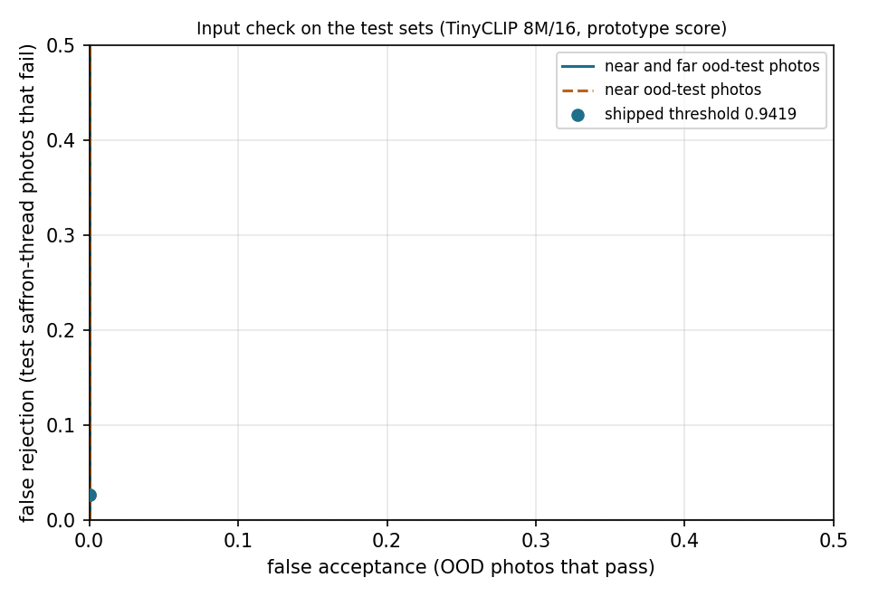</p>

**The out-of-distribution set.** 222 openly licensed photos from Wikimedia Commons (CC0, public domain, CC BY,
CC BY-SA): 100 near, 40 grey zone and 82 far, including the 7 original OOD photos. It was split once, before any
tuning, into ood-tune (91) and ood-test (131), stratified by category with a fixed seed. Per-category results
and credits are in [`docs/ood/`](docs/ood/README.md).

**What it cannot do.**
- **Small numbers.** 15 test photos per class: the intervals above are wide, and "0 of 60" does not mean the
  check never lets a look-alike through.
- **It compares with the training photos**, taken with one phone on a few papers. The two rejected test photos
  are pure classes, which were photographed on distinctive paper (the background confound in
  [Explainability](#explainability)). Threads photographed on other paper, with other phones or in other light
  may be turned away more often; no such photos were available to measure this.
- **The grey zone** was turned away in this set (safflower and corn silk as flowers, silks or heaps; saffron as
  piles). A single safflower petal or corn silk strand laid on paper like the training photos is untested.
- **Latency.** The encoder and input size are the same as in the poultry app, measured there
  ([`browser_bench.json`](https://github.com/peerzadarabet1807/poultry-disease-detection/blob/main/results/input_check/browser_bench.json)):
  68.0 ms per photo on an integrated Intel GPU (WebGL), 212.5 ms on WebAssembly on the same laptop, 918.8 ms on an
  emulated mid-range phone.

**Parity** ([`results/input_check/parity_float16.json`](results/input_check/parity_float16.json)): on 18
committed fixtures (10 samples, the EXIF fixture, the 7 original OOD photos), TF.js matches the original PyTorch
model with the same pass/fail decision on all 18, and at cosine ≥ 0.9999995 where the 224 × 224 input is
identical. Node's `sharp` decodes the progressive sample JPEGs slightly differently from Pillow, and the area
filter port differs from OpenCV by 1 on a few values, so 14 of the 18 inputs differ slightly; their cosine is at
least 0.9955. In Chromium every sample passes, with scores close to Python's (the e2e test logs them).

## Limitations and threats to validity

1. **Background confound (above).** The pure classes are partly recognised by their photo background.
2. **Small test set.** 15 images per class: one error moves a class's recall by about **6.7 points**. Treat
   per-class differences of that size as noise.
3. **Optimistic validation scores.** The validation set drove early stopping, the hyperparameter search and
   model selection, so validation scores (1.000 for the chosen model) are optimistic by construction. **Quote
   the test score.**
4. **Narrow capture conditions.** Every image is a single thread on light paper, taken with one phone, of
   saffron from one region. Other cameras, lighting, backgrounds or origins are untested.
5. **A closed set of five answers.** There is no "not saffron" or "mixed sample" class, so the model **always**
   outputs one of the five classes. On seven openly licensed photos of red thread, yarn and fabric, the web
   app's low-confidence warning fired for 5; the other 2, both red thread on a light background, were
   classified confidently as C3 (75% and 83%). See [`docs/ood/`](docs/ood/README.md). The
   [input check](#input-check) now turns all seven away, but it is a safeguard, not a guarantee.
6. **Uncalibrated probabilities.** One test error was 78.6% confident. Temperature scaling on a separate
   calibration split is future work.
7. **Baseline comparison.** The thesis figures come from a different split and protocol.

## The web app

**Live:** <https://peerzadarabet1807.github.io/saffron-adulteration-detection/>

| | |
|---|---|
| 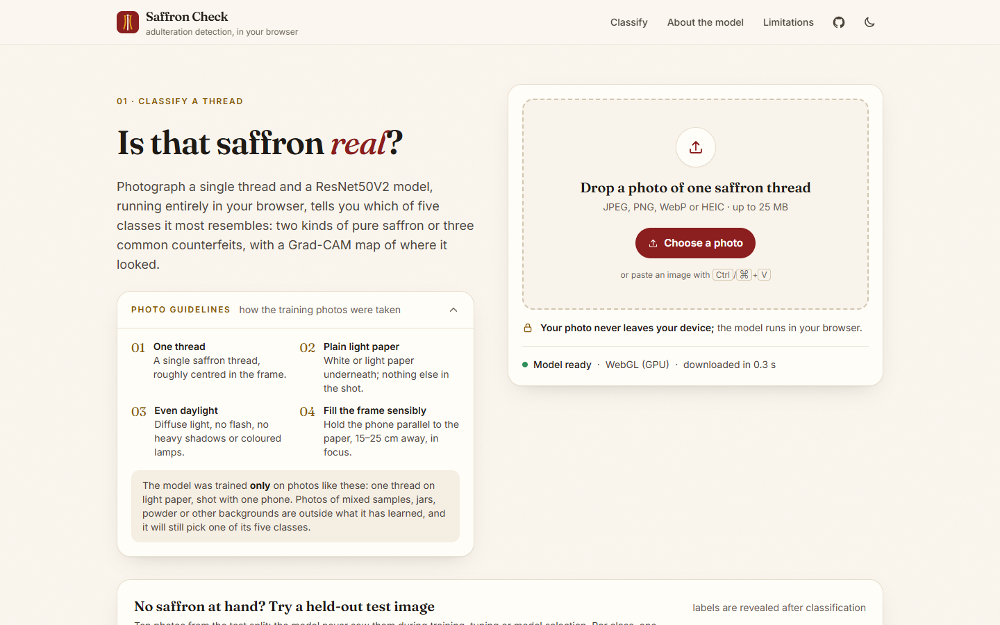 | 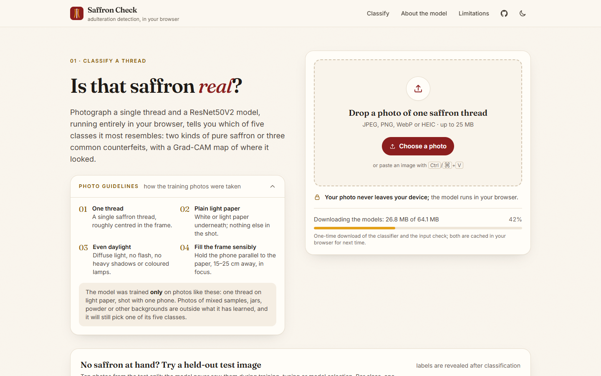 |
| **Landing:** drop, pick, paste or photograph a thread | **First visit:** both models (64 MB) with progress, then cached |
| 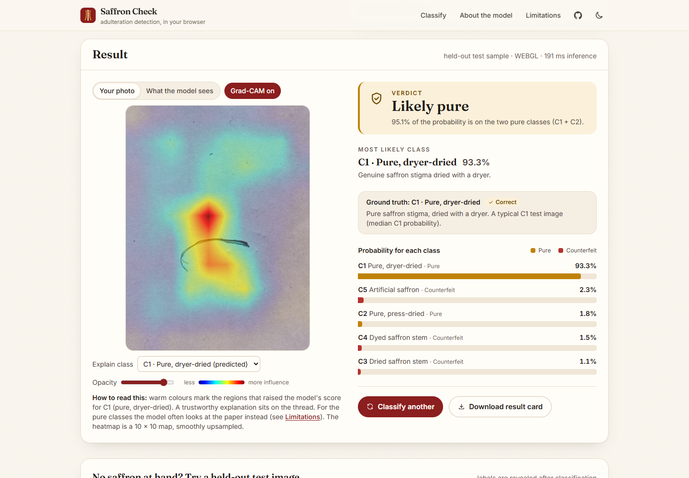 |  |
| **Pure:** C1 at 93.3%; Grad-CAM partly on the paper | **Counterfeit:** C4 at 92.5%; Grad-CAM on the thread |
| 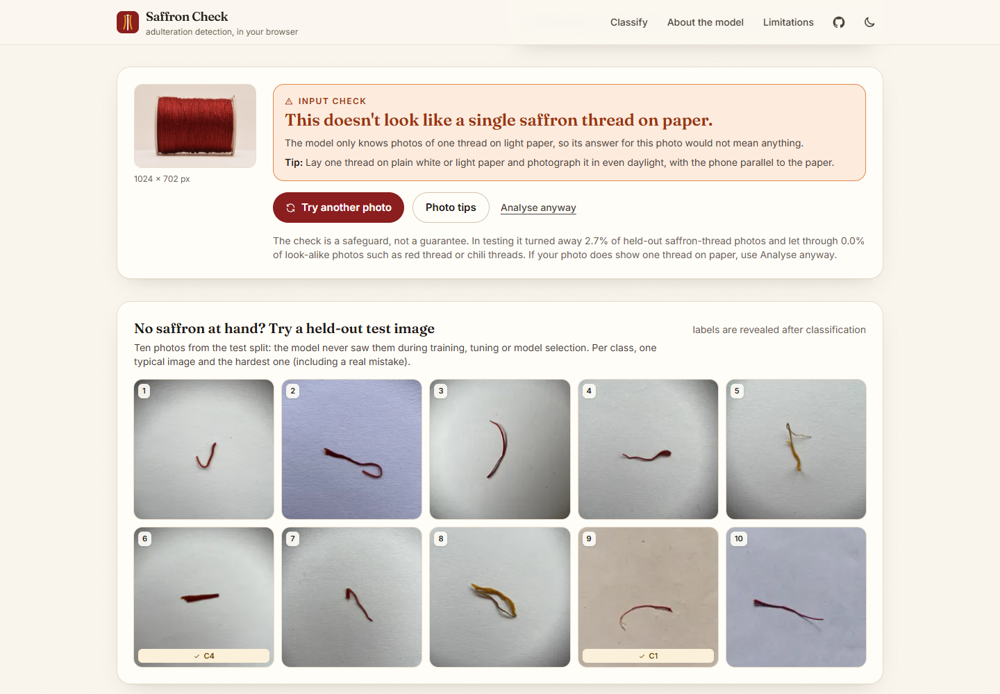 | 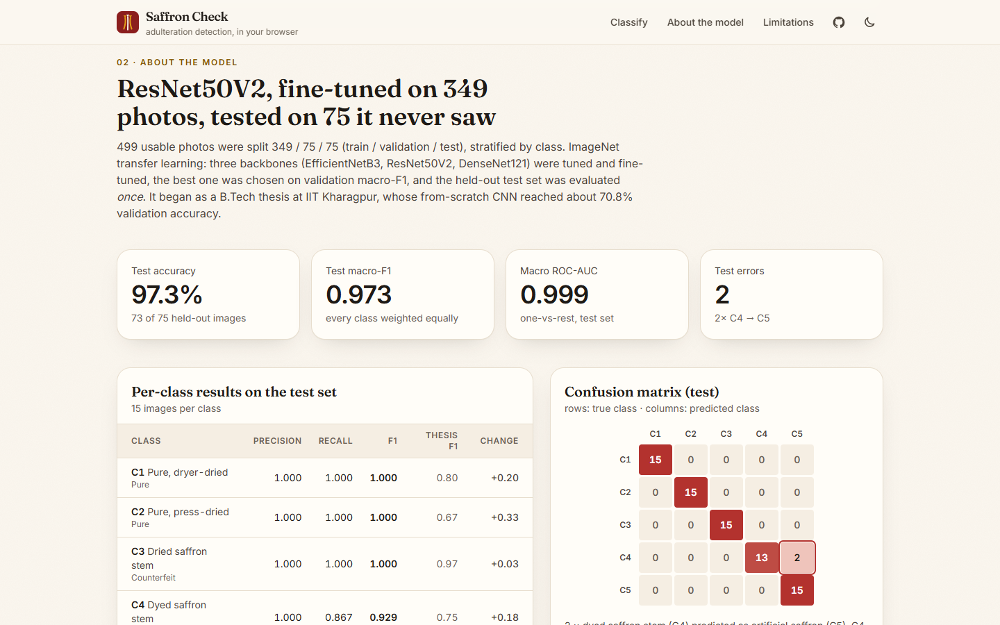 |
| **Not saffron:** the input check turns a photo of a thread spool away | **About the model:** every number is read from `metrics.json` |
| 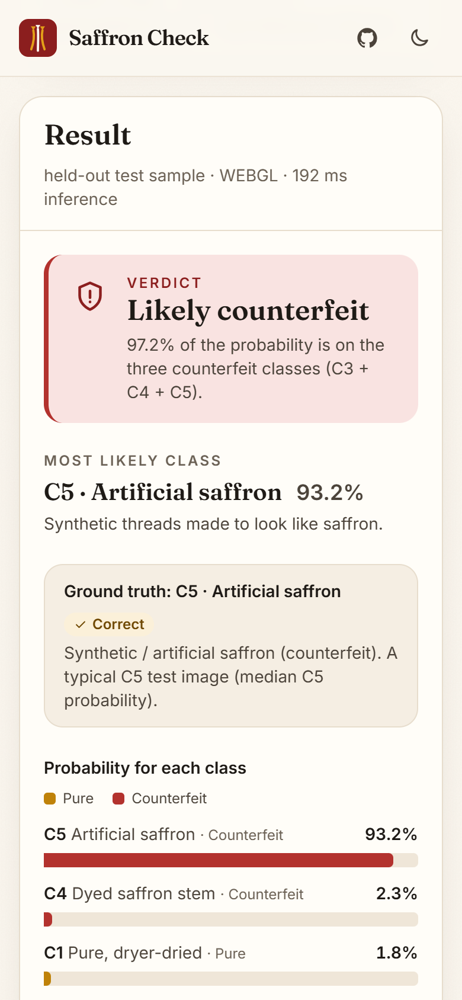 | 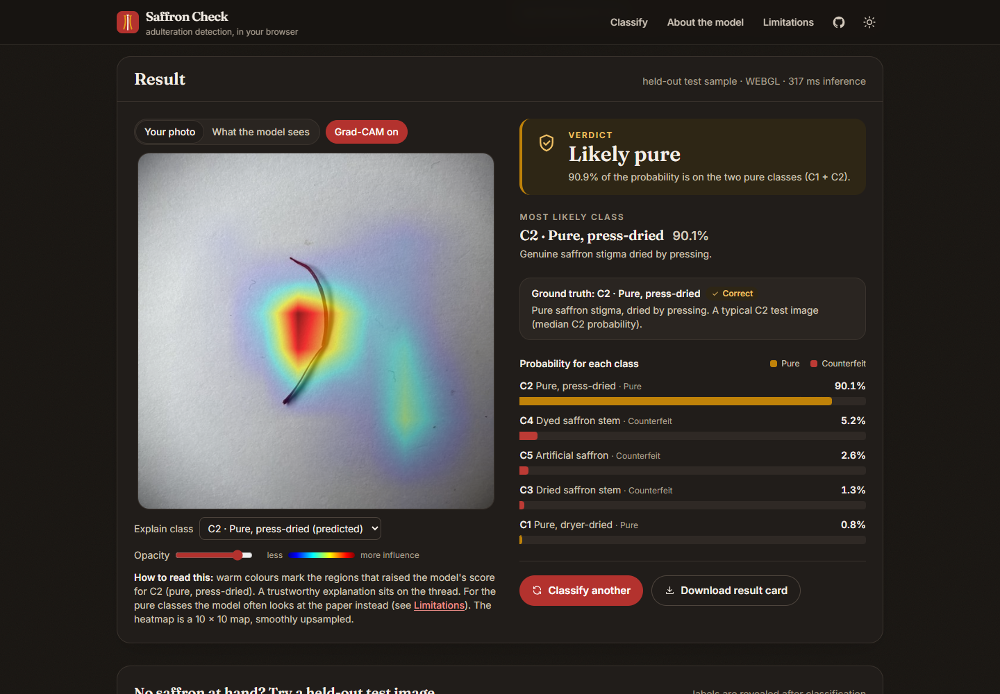 |
| **Mobile:** verdict first, camera capture button | **Dark mode** |
| 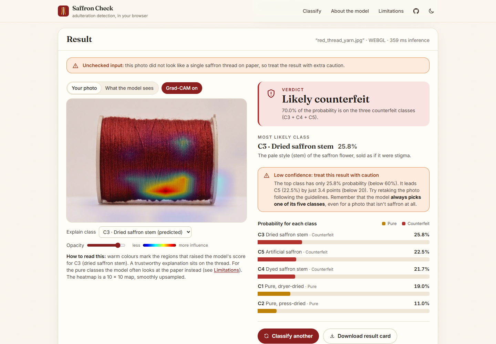 | 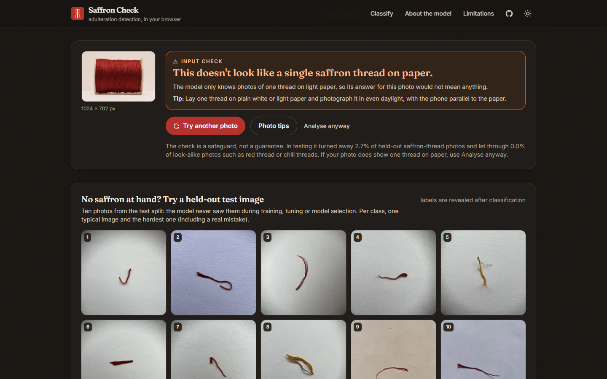 |
| **Analyse anyway:** the classifier still answers, now labelled "Unchecked input" | **Input check notice, dark theme** |

All screenshots were captured from the production build with
[`web/scripts/capture-screenshots.ts`](web/scripts/capture-screenshots.ts). The inference times shown were
measured on an integrated Intel UHD GPU.

**Features**
- Drag-and-drop, file picker, paste (Ctrl/⌘+V) and, on phones, **Take a photo**. JPEG, PNG, WebP and
  **HEIC** (the iPhone default, decoded natively in Safari or with a lazily loaded `heic2any` elsewhere).
  Non-images and files over 25 MB are rejected by file signature, with a clear message.
- **Try a sample:** ten held-out test images (per class, the median and the hardest), with labels revealed
  after classification, including one real mistake.
- **Input check first.** A photo that does not look like one thread on paper gets a notice instead of a verdict,
  with **Try another photo**, **Photo tips** and **Analyse anyway** (the result is then labelled "Unchecked
  input"). See [Input check](#input-check) for how it works and its measured error rates.
- **Verdict** ("Likely pure" / "Likely counterfeit") from group probabilities (C1 + C2 vs C3 + C4 + C5), the top
  class with its description, and **probability bars** for all five classes.
- A **low-confidence warning** when the top probability is below 0.60 or the top-2 margin below 0.20. For
  softmax outputs the margin rule only fires together with the first one, since top ≥ 0.6 leaves at most 0.4
  for the runner-up.
- **Grad-CAM overlay** for any class, with an opacity slider, and **"What the model sees"** (the 300 × 300
  squashed input).
- A downloadable **result card** (PNG), light and dark themes, keyboard- and screen-reader-friendly (focus
  moves to the result, live-region announcements), and reduced-motion aware.

**Architecture**

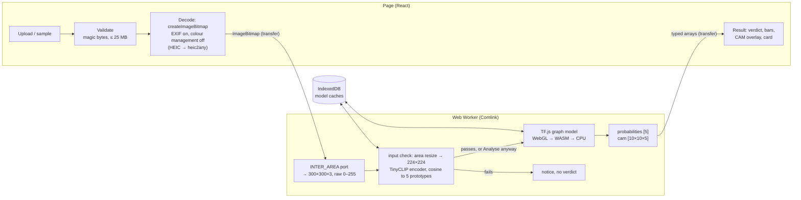

- **Everything runs off the UI thread** in a Web Worker: backend selection (WebGL, then WASM, then CPU), the
  download of both models in parallel with progress, the IndexedDB caches (keyed by each model's content hash), warm-up with
  **parallel shader compilation**, preprocessing and inference. Where workers have no WebGL (Safari 16), the
  same code runs on the page thread with WebGL. The model starts downloading once the page has loaded.
- **One forward pass** returns probabilities and CAMs; the heatmap is ReLU'd, min-max normalised, upsampled
  bilinearly and colour-mapped before it is drawn.
- Tensors are always disposed (a unit test and an e2e test check the tensor count).

**Preprocessing contract** (must match training exactly)

| Step | Training (Python) | Browser |
|---|---|---|
| Decode | PIL | `createImageBitmap` |
| Orientation | `ImageOps.exif_transpose` | `imageOrientation: "from-image"` (+ a JPEG EXIF check) |
| Colour | raw values, no ICC conversion | `colorSpaceConversion: "none"` (the photos are Display-P3) |
| Resize | `cv2.resize(…, (300, 300), INTER_AREA)`, full frame, **no crop** | exact JS port of OpenCV's area filter, tested against `cv2` |
| Scale | none: float32 in [0, 255] | none (normalisation is inside the model) |

**Keras ↔ browser parity** ([`models/tfjs_parity.json`](models/tfjs_parity.json))

| TF.js variant | Size | Same top class (75 test images) | Max prob. difference | Min CAM correlation | Shipped |
|---|---|---|---|---|---|
| **float16** | 47.2 MB | 100% | **0.0021** | 0.99998 | ✅ |
| uint8 | 23.7 MB | 100% | 0.122 | 0.966 | ❌ fails the 0.02 / 0.98 bar |

The input check's encoder has its own parity test against PyTorch (see [Input check](#input-check)).

End to end in the browser (decoding, the area filter and WebGL), Playwright checks every sample against its
Keras reference: the largest probability difference is **0.0006** in Chromium. The e2e suite passes in
Chromium, Firefox, WebKit and an emulated Pixel 7, including HEIC and EXIF-rotated uploads.

**Lighthouse** (13.5.0, median of 3 runs, headless Chromium on the same machine and day; after:
[`docs/lighthouse/summary.json`](docs/lighthouse/summary.json), before the input check (`main` at `66365de`):
[`before_input_check.json`](docs/lighthouse/before_input_check.json); script:
[`web/scripts/lighthouse.mjs`](web/scripts/lighthouse.mjs))

| | Performance before → after | Accessibility | Best practices | SEO |
|---|---|---|---|---|
| Mobile, excluding the model download | 93 → **93** | 100 → 100 | 100 → 100 | 100 → 100 |
| Desktop, excluding the model download | 100 → **100** | 100 → 100 | 100 → 100 | 100 → 100 |
| Mobile, models downloading in the background | 93 → **93** | 100 → 100 | 100 → 100 | 100 → 100 |
| Desktop, models downloading in the background | 100 → **100** | 100 → 100 | 100 → 100 | 100 → 100 |

"Excluding the model download" loads the page with `?preload=0`, because Lighthouse cannot block a worker's
requests. In these runs the "downloading" rows score like the others, which suggests the download (47 MB
classifier and 17 MB input check, started once the page has loaded) began after Lighthouse stopped measuring;
an earlier run (2026-09-24) scored 77 on mobile and 80 on desktop with the download. Treat those two rows as an
upper bound.

## Reproduce the training

1. Open the notebook in Colab with the badge above, and choose **Runtime → Change runtime type → T4 GPU**.
2. Put the dataset on Google Drive as `MyDrive/data/C1 … C5` (one folder per class). The photos are not
   public; you need your own, or ones obtained from the author.
3. **Runtime → Run all.** Artefacts are written to `MyDrive/saffron_adulteration_artifacts/`.

Expected runtime on a T4 is roughly **30 to 50 minutes**. In the recorded run, loading 500 full-size photos
from Drive took 4.8 min, the hyperparameter search 14.1 min, and two-phase training 9.8 min for all three
backbones (2.6 + 3.5 + 3.7). The recorded environment was TensorFlow 2.20.0, Keras 3.13.2, Albumentations
2.0.8 and OpenCV 5.0.0 on a Tesla T4. The executed notebook, with all outputs, is in
[`notebooks/`](notebooks/saffron_adulteration_transfer_learning.ipynb).

To download the trained weights instead, see [`models/README.md`](models/README.md) (GitHub Release `v1.0.0`).

## Run the web app locally

```bash
cd web
npm ci
npm run dev            # http://localhost:5173/saffron-adulteration-detection/
npm test               # unit tests (Vitest, 76 tests)
npm run lint && npm run typecheck
npm run build && npm run preview
npx playwright install chromium firefox webkit
npm run e2e            # Playwright end-to-end tests against the preview build
```

**Rebuild the browser model** from `best_model.keras` (Python 3.11):

```bash
python -m venv .venv-ml && .venv-ml/Scripts/pip install -r scripts/requirements.txt   # bin/ on Linux/macOS
python scripts/build_web_model.py            # probabilities + CAM graph, verified, exported to build/
bash scripts/convert_to_tfjs.sh              # float16 and uint8 variants in an isolated venv
python scripts/reproduce_test_split.py       # [needs dataset]
python scripts/make_reference_predictions.py # Keras references (+ test-set re-check)
PARITY_MODEL_DIR=../build/tfjs/float16 npm --prefix web run test:parity
bash scripts/convert_to_tfjs.sh --install float16
```

The parity test runs TF.js on its WASM backend in Node, because `@tensorflow/tfjs-node` has no working
Windows build for Node 22. It needs the local `build/reference` artefacts, so it runs locally rather than in CI.

**Rebuild the input check** (needs the raw photos; a second venv with
[`scripts/requirements-gate.txt`](scripts/requirements-gate.txt) for PyTorch):

```bash
python scripts/reproduce_test_split.py --data data      # [needs dataset] build/test_split.json
python scripts/gate_extract.py                          # [needs dataset] 224 x 224 inputs + classifier outputs
python scripts/build_input_check.py                     # gate venv: prototypes, threshold, evaluation
python scripts/make_gate_references.py seen             # parity fixtures (committed photos only)
python scripts/make_gate_references.py embed            # gate venv
PARITY_VARIANT=float16 npm --prefix web run test:parity
```

The OOD set itself: `python scripts/build_ood_set.py --discover` (candidates and contact sheets),
`python scripts/build_ood_set.py` (downloads the committed `docs/ood/selection.json`),
`python scripts/split_ood.py` (once) and `python scripts/write_ood_credits.py`.

## Repository structure

```
├── notebooks/        executed Colab training notebook (outputs kept)
├── results/          metrics.json, CSV reports and every figure from the training run;
│                     input_check/ (evaluation, figure, parity)
├── models/           class names, model card, parity report, input check rule (input_check.json);
│                     weights are in the GitHub Release
├── scripts/          Python: web-model build, TF.js conversion, split reproduction, references,
│                     samples, figures, non-saffron evaluation, OOD set, input check
├── web/              Vite + React + TypeScript app
│   ├── public/model/     sharded TF.js graph model (float16, 12 × ≤ 4 MiB)
│   ├── public/gate/      input check image encoder, TinyCLIP ViT-8M/16 (float16, 4 shards, MIT notice)
│   ├── public/samples/   10 held-out test images (600 px) + manifest
│   ├── src/              UI, worker, preprocessing, CAM
│   └── tests/            unit, parity and Playwright e2e tests + fixtures
├── docs/             screenshots, ood/ (222 non-saffron photos, credits, tune/test split), Lighthouse
│                     summaries
└── .github/workflows CI (lint, types, tests, build) and GitHub Pages deploy
```

## Model card

See [`models/MODEL_CARD.md`](models/MODEL_CARD.md) for intended use, out-of-scope uses, data, metrics,
limitations and ethical considerations. In short: this is a research and teaching prototype for single-thread
photos taken like the training data. It must not be used to certify saffron or to accuse a seller.

## Roadmap

- [ ] Re-shoot all classes on **one standardised background** with fixed lighting (fixes the confound)
- [ ] **External test set** from other days, papers, phones and origins
- [x] An **input check** in front of the classifier ("not a single thread on paper"), November 2026
- [ ] Input check photos from **other papers, phones and lighting**, to measure false rejection outside the
      training setting
- [ ] **Mixed-sample** detection (adulterant threads among genuine ones)
- [ ] **Spectral or chemical fusion** (e.g. UV-Vis crocin / picrocrocin / safranal markers, as in ISO 3632)
- [ ] **Calibration** (temperature scaling on a held-out calibration split)
- [ ] **K-fold cross-validation** to put confidence intervals on the small-sample metrics

## Citation

If you use this work, please cite it (see [`CITATION.cff`](CITATION.cff)):

```bibtex
@software{rabet_saffron_adulteration_2026,
  author  = {Rabet, Peerzada Mohammad},
  title   = {Saffron adulteration detection with transfer learning and an in-browser Grad-CAM classifier},
  year    = {2026},
  version = {1.0.0},
  url     = {https://github.com/peerzadarabet1807/saffron-adulteration-detection}
}
```

**Related work.** Momeny, M., Neshat, A. A., Jahanbakhshi, A., Mahmoudi, M., Ampatzidis, Y., & Radeva, P.
(2023). *Grading and fraud detection of saffron via learning-to-augment incorporated Inception-v4 CNN.* Food
Control, 147, 109554. <https://doi.org/10.1016/j.foodcont.2022.109554>. Their LAII-v4 CNN is prior work on
image-based saffron grading and fraud detection.

## Acknowledgements

This project began as my bachelor's thesis under the supervision of **Dr. Mamoni Banerjee**, Rajendra Mishra
School of Engineering Entrepreneurship (RMSOEE), IIT Kharagpur. Thank you for the guidance. The non-saffron
test photos are by Wikimedia Commons contributors, credited in [`docs/ood/CREDITS.md`](docs/ood/CREDITS.md).
The input check uses the image encoder of TinyCLIP (Wu et al., ICCV 2023; Microsoft, MIT licence, notice in
[`web/public/gate/LICENSE.txt`](web/public/gate/LICENSE.txt)). Fonts are Fraunces and Inter (SIL OFL 1.1).

## License and contact

Code and model weights: [MIT](LICENSE). The input check's TinyCLIP weights: MIT, Copyright (c) Microsoft
Corporation. The training photos are not included. The non-saffron photos in
`docs/ood/` keep their own Creative Commons licenses.

**Peerzada Mohammad Rabet**, B.Tech Agricultural and Food Engineering, IIT Kharagpur (2024) ·
GitHub [@peerzadarabet1807](https://github.com/peerzadarabet1807) · peerzada.rabet2@gmail.com
