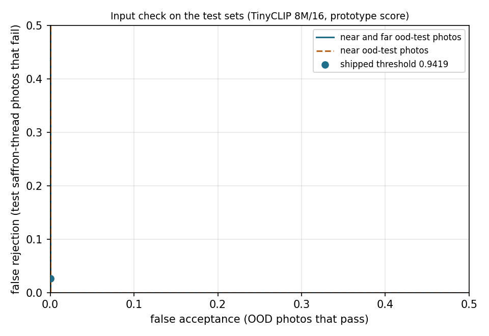

# Input check: evaluation of the shipped gate

Written by [`scripts/build_input_check.py`](../../scripts/build_input_check.py). Gate `saffron-tinyclip-8m16-proto-1`: TinyCLIP ViT-8M/16 image embedding of the 224 x 224 image, cosine to the nearest of five class prototypes (mean embeddings of the training photos), threshold 0.941946: the highest value with at most 1% false rejection on the 75 validation photos, which here means the lowest validation score. The test split and ood-test played no part in any choice. Rates: percent (count; 95% Wilson interval). With 15 test photos per class the intervals are wide.

## False rejection (saffron-thread photos the check turns away)

| Class | Validation (tuning) | Test |
|---|---|---|
| C1 | 0.0% (0/15; 0.0 to 20.4) | 6.7% (1/15; 1.2 to 29.8) |
| C2 | 0.0% (0/15; 0.0 to 20.4) | 6.7% (1/15; 1.2 to 29.8) |
| C3 | 0.0% (0/15; 0.0 to 20.4) | 0.0% (0/15; 0.0 to 20.4) |
| C4 | 0.0% (0/15; 0.0 to 20.4) | 0.0% (0/15; 0.0 to 20.4) |
| C5 | 0.0% (0/15; 0.0 to 20.4) | 0.0% (0/15; 0.0 to 20.4) |
| **All** | 0.0% (0/75; 0.0 to 4.9) | 2.7% (2/75; 0.7 to 9.2) |

## False acceptance (ood-test photos that pass)

| Category | Near, grey or far | Passed |
|---|---|---|
| chili threads | near | 0.0% (0/6; 0.0 to 39.0) |
| food | near | 0.0% (0/9; 0.0 to 29.9) |
| hair | near | 0.0% (0/6; 0.0 to 39.0) |
| red fabric | near | 0.0% (0/8; 0.0 to 32.4) |
| red objects | near | 0.0% (0/7; 0.0 to 35.4) |
| red thread yarn | near | 0.0% (0/11; 0.0 to 25.9) |
| saffron flower | near | 0.0% (0/7; 0.0 to 35.4) |
| saffron packaged | near | 0.0% (0/6; 0.0 to 39.0) |
| corn silk | grey | 0.0% (0/7; 0.0 to 35.4) |
| safflower | grey | 0.0% (0/7; 0.0 to 35.4) |
| saffron loose | grey | 0.0% (0/10; 0.0 to 27.8) |
| documents | far | 0.0% (0/8; 0.0 to 32.4) |
| everyday objects | far | 0.0% (0/8; 0.0 to 32.4) |
| other animals | far | 0.0% (0/8; 0.0 to 32.4) |
| people | far | 0.0% (0/7; 0.0 to 35.4) |
| scenes | far | 0.0% (0/8; 0.0 to 32.4) |
| screenshots | far | 0.0% (0/8; 0.0 to 32.4) |
| **All near** | near | 0.0% (0/60; 0.0 to 6.0) |
| **All far** | far | 0.0% (0/47; 0.0 to 7.6) |
| **All grey zone** | grey | 0.0% (0/24; 0.0 to 13.8) |

On ood-tune (seen while setting up the categories): near 0.0% (0/40; 0.0 to 8.8), far 0.0% (0/35; 0.0 to 9.9), grey 0.0% (0/16; 0.0 to 19.4).

Passing near or far ood-test photos: none.
Passing grey-zone ood-test photos: none.

AUROC, test photos against near and far ood-test: 1.0000 (near only: 1.0000).

## Shipped sample photos

10 of 10 pass.

## Post-hoc observations

Not used for any choice.

The classifier gets 2 of 75 test photos wrong; the check turns away 0.0% (0/2; 0.0 to 65.8) of those and 2.7% (2/73; 0.8 to 9.5) of the photos it gets right.

On near and far ood-test photos the classifier alone gives a confident answer (not 'low confidence') for 9.3% (10/107; 5.2 to 16.4); with the input check in front, for 0.0% (0/107; 0.0 to 3.5).
